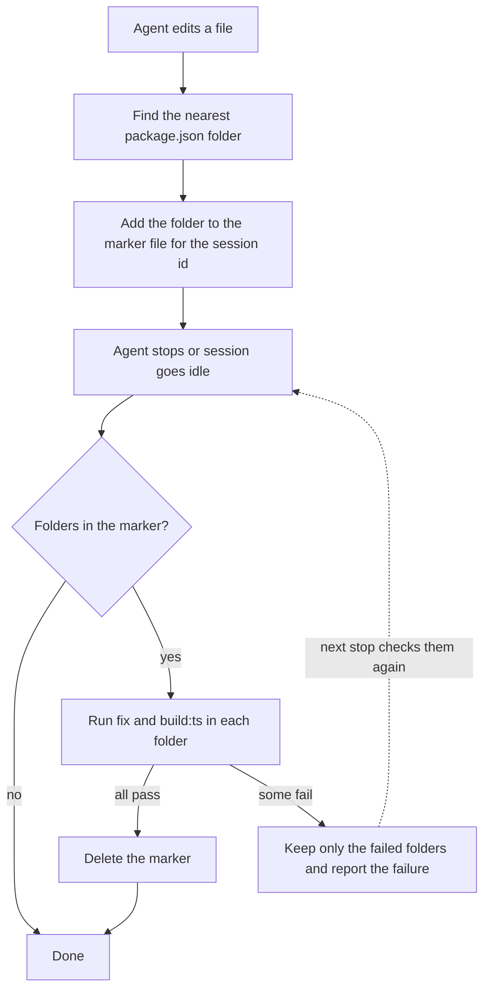

# Agent setup

The `.agents` folder holds the skills and hooks that coding agents use in this repository. Claude Code, Codex and OpenCode share one source here, so you write a skill or a check once and each agent gets it through a thin pointer or config.

## Skills

The skill body lives in `.agents/skills/<name>/SKILL.md`. Codex and OpenCode read it from there. Claude Code does not, so `.claude/commands/<name>.md` holds a pointer that tells it to read the skill file. OpenCode also gets a pointer in `.opencode/commands/<name>.md`, which gives the `/name` slash command.

To add a skill, write `SKILL.md` with `name` and `description` in the front matter. Then copy an existing pointer in both `commands` folders and change the name and description.

## Change check

Every sample and workshop is a separate npm project. When the agent edits a file, the hook finds the nearest folder with `package.json` below the repository root, for example `samples/simple`, and records it for the session. When the agent stops, the hook runs `npm run fix` and then `npm run build:ts` in each recorded folder. Edits outside any sample or workshop, such as the root `README.md`, do not trigger a check. The hooks do not use `git diff`, because you can have your own uncommitted changes that the agent did not make.



The marker is a file at `node_modules/.cache/agent-check/<session_id>` in the repository root, with one folder per line. On failure, Claude Code and Codex get exit code 2 with the check output, which blocks the stop and gives the output back to the agent. OpenCode shows an error toast and writes the output to the OpenCode log.

The hook reads the edited paths from the tool input:

| Agent       | On edit                                                                                                                        | On stop                                   | Where configured                       |
| ----------- | ------------------------------------------------------------------------------------------------------------------------------ | ----------------------------------------- | -------------------------------------- |
| Claude Code | `PostToolUse` on `Edit\|Write\|MultiEdit\|NotebookEdit` runs `record-edit.ts`, which reads `file_path` or `notebook_path`       | `Stop` runs `validate-change.ts`          | `.claude/settings.json`                |
| Codex       | `PostToolUse` on `apply_patch\|Edit\|Write` runs `record-edit.ts`, which reads the patch file lines from `command`, relative to `cwd` | `Stop` runs `validate-change.ts`          | `.codex/hooks.json`                    |
| OpenCode    | `tool.execute.after` on `edit`, `write`, `apply_patch` reads `filePath` or `patchText`                                         | `session.status` event with `idle` status | `.opencode/plugins/validate-change.ts` |

OpenCode loads the plugin from `.opencode/plugins/`. The plugin keeps the edited folders per session in memory, so it does not write marker files.

Edge cases:

- If `stop_hook_active` is set, the stop hook skips the check. This prevents a loop when the agent continues after a blocked stop.
- If the session id is missing or has characters other than letters, digits, `-` and `_`, the edit is not recorded and the stop hook does not run the check.
- Files inside `node_modules` and outside the repository are ignored.
- The hooks find the repository root with `git rev-parse --show-toplevel`, so the marker and the check use the root also when the agent works in a subdirectory.
- If the edited sample has no `node_modules`, the check fails. Run `npm ci` in that folder.
- The OpenCode plugin runs the check asynchronously, so it does not block OpenCode. Only one check runs at a time.

## Tests

Run the tests for the hooks and the plugin from the repository root:

```shell
npm run test:agents
```

The tests use the Node.js test runner, so they need no dependencies. Unit specs test the small functions without I/O. Integration specs run the hooks and the plugin against a temporary Git repository with fake packages whose `fix` and `build:ts` scripts record each run.
