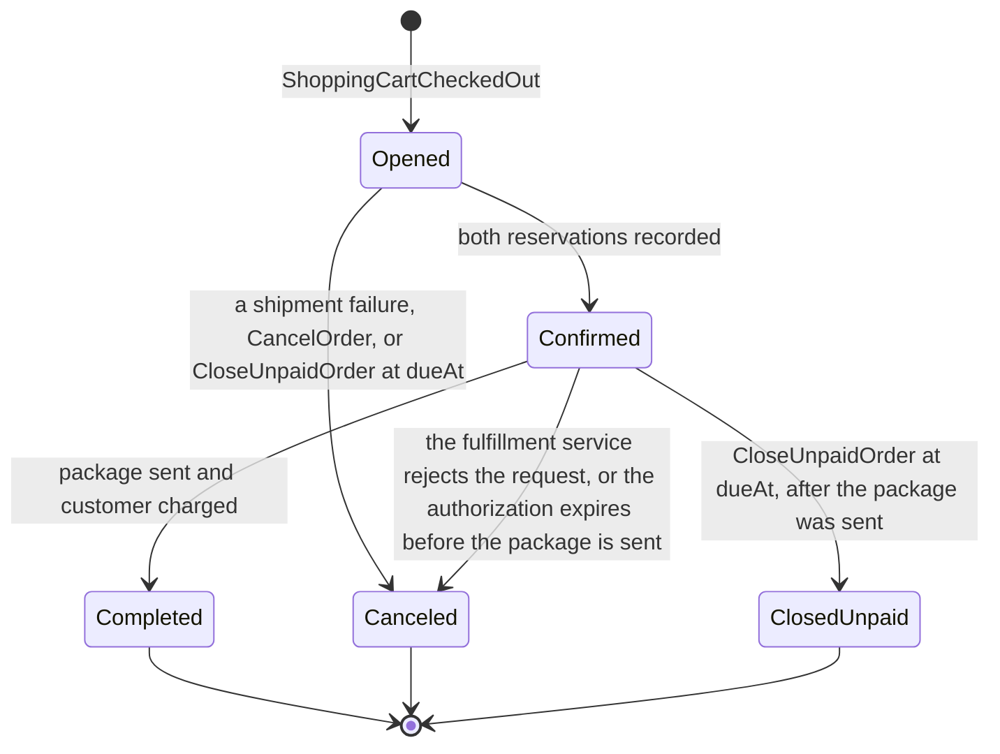

## Overview

The aggregate behind the orders module. [Order](https://github.com/oskardudycz/EventSourcing.NodeJS/blob/main/samples/e-commerce/packages/application/src/orders/order.ts) is the state, folded from the order's stream, and the [order workflow](https://github.com/oskardudycz/EventSourcing.NodeJS/blob/main/samples/e-commerce/packages/application/src/orders/orderWorkflow.ts) decides the events. The order keeps only the other contexts' ids: their models stay in their contexts.

<EntityPropertiesTable />

## States

The order holds one status for each participant:

| Participant | Statuses |
|---|---|
| payment | `Pending` → `Authorized` → `Captured` (only after `Sent`), or `Failed`; paying again goes from `Failed` to `Retrying` and then `Authorized`, before the confirmation or after `Sent` |
| shipment | `Pending` → `Reserved` → `Sent`, or `Failed` (out of stock), or `Rejected` (the products are still reserved) |

and goes through these statuses itself:

The [README](https://github.com/oskardudycz/EventSourcing.NodeJS/tree/main/samples/e-commerce#the-order-decides) explains why the order decides.
