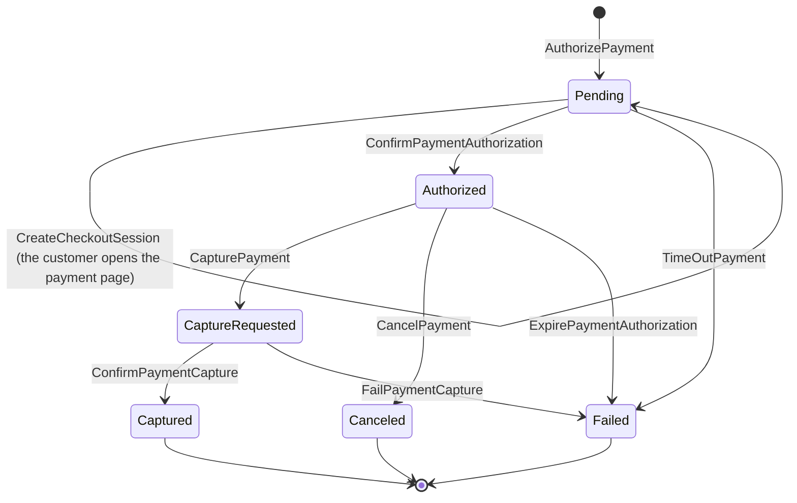

## Overview

The aggregate behind the payments module. [Payment](https://github.com/oskardudycz/EventSourcing.NodeJS/blob/main/samples/e-commerce/packages/application/src/payments/payment.ts) is the state, folded from the payment's stream, and the [payment workflow](https://github.com/oskardudycz/EventSourcing.NodeJS/blob/main/samples/e-commerce/packages/application/src/payments/paymentWorkflow.ts) decides the events.

<EntityPropertiesTable />

## States

A payment follows the payment providers' own steps: the customer authorizes it on the provider's page, and the shop charges it later. The commands match the providers' operations and webhooks:

| Ours | Stripe | Adyen |
|---|---|---|
| `CreateCheckoutSession` | create a Checkout Session with `capture_method: manual` | create a payment session |
| `ConfirmPaymentAuthorization` | the `payment_intent.amount_capturable_updated` webhook, with `capture_before` | the `AUTHORISATION` webhook |
| `TimeOutPayment` | expire the Checkout Session | no such operation |
| `CapturePayment` | capture the PaymentIntent | capture |
| `CancelPayment` | cancel the PaymentIntent | cancel |
| `ExpirePaymentAuthorization` | the authorization lapses and the funds are released | the transaction expires |

The [README](https://github.com/oskardudycz/EventSourcing.NodeJS/tree/main/samples/e-commerce#where-the-steps-come-from) explains each step and its sources.
