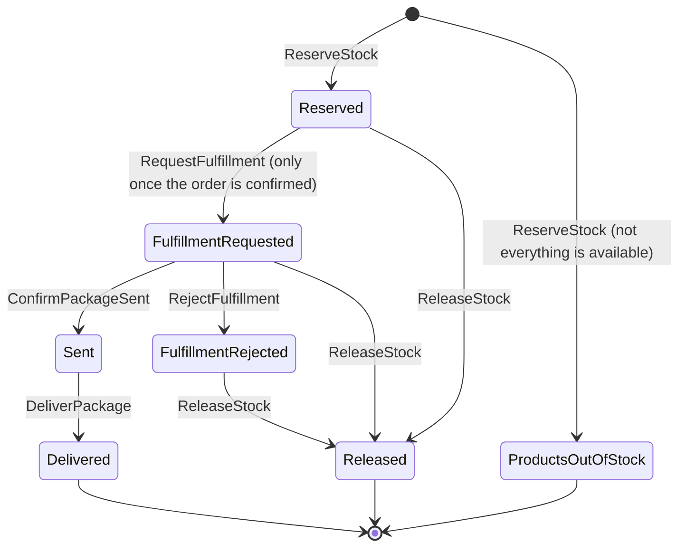

## Overview

The aggregate behind the shipments module. [Shipment](https://github.com/oskardudycz/EventSourcing.NodeJS/blob/main/samples/e-commerce/packages/application/src/shipments/shipment.ts) is the state, folded from the shipment's stream, and the [shipment workflow](https://github.com/oskardudycz/EventSourcing.NodeJS/blob/main/samples/e-commerce/packages/application/src/shipments/shipmentWorkflow.ts) decides the events.

<EntityPropertiesTable />

## States

A shipment reserves the products, asks the fulfillment service to send them, and releases them if the order is canceled first:

The [README](https://github.com/oskardudycz/EventSourcing.NodeJS/tree/main/samples/e-commerce#where-the-steps-come-from) explains each step and its sources.
